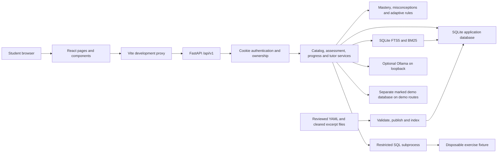
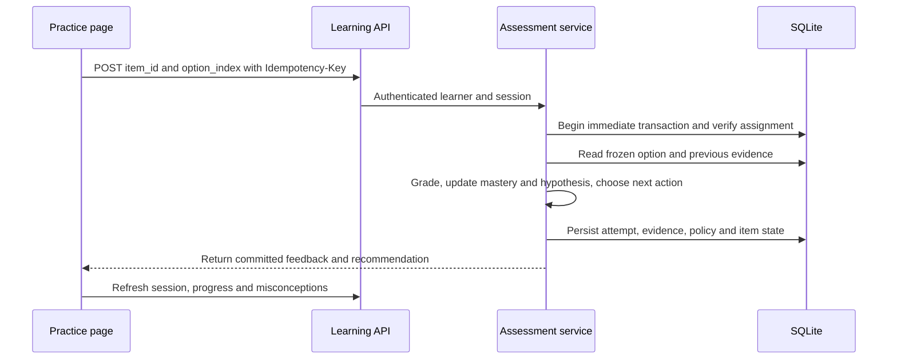
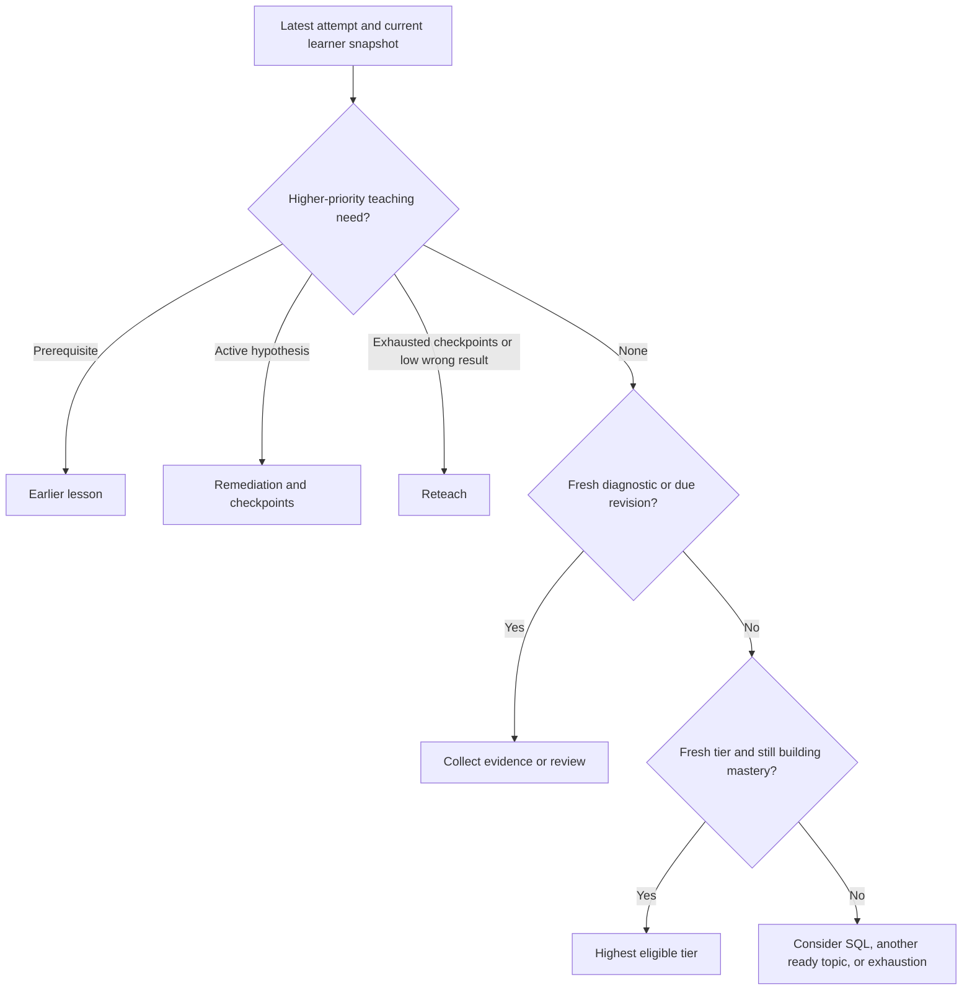
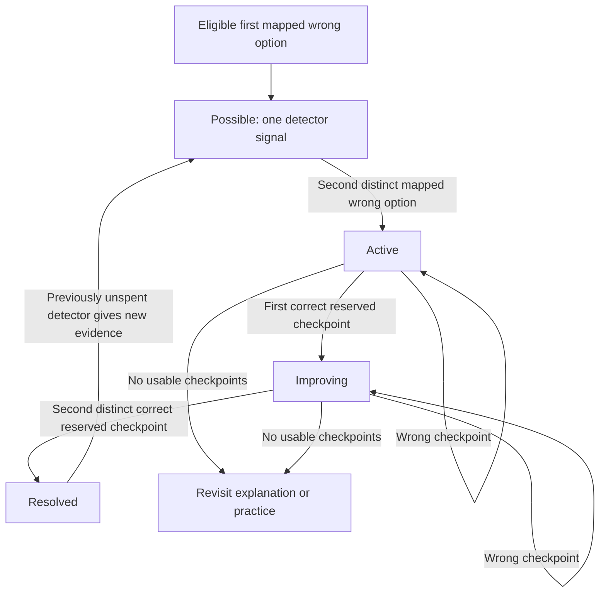
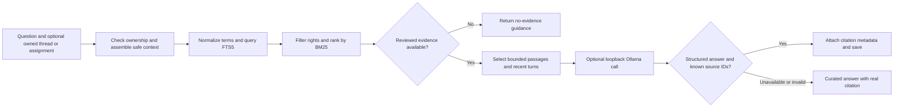
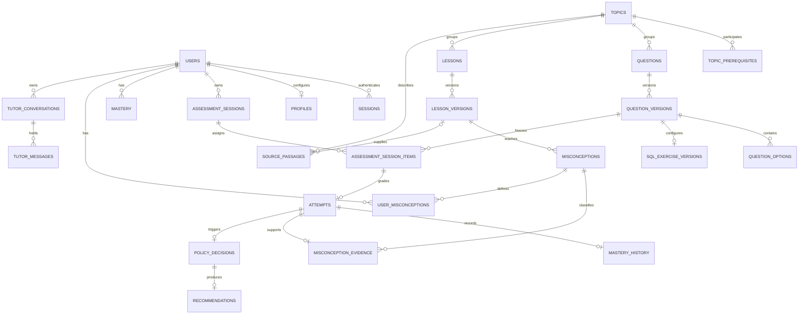

# Adaptive DBMS Tutor — Complete Project Handbook

**Implementation baseline** · `0f9d664` · 25 November 2026. The handbook describes the local learner product, its source code and the verification recorded for that implementation. Use Parts 1–3 for a first walkthrough, Parts 5–15 to understand the internals, and Part 16 to prepare for a demo or viva. The full baseline commit is `0f9d6647cafd7bd8d3ee12c43e1ec9b67409baea`.

## Table of contents

1. [Project overview](#part-1--project-overview)
2. [Complete feature guide](#part-2--complete-feature-guide)
3. [Full user manual](#part-3--full-user-manual)
4. [Complete technology stack](#part-4--complete-technology-stack)
5. [System architecture](#part-5--system-architecture)
6. [Adaptive learning algorithm](#part-6--adaptive-learning-algorithm)
7. [Misconception detection engine](#part-7--misconception-detection-engine)
8. [MCQ bank and educational content](#part-8--mcq-bank-and-educational-content)
9. [AI tutor, LLM and RAG](#part-9--ai-tutor-llm-and-rag)
10. [Books and learning resources](#part-10--books-and-learning-resources)
11. [SQL laboratory](#part-11--sql-laboratory)
12. [Database design](#part-12--database-design)
13. [API reference](#part-13--api-reference)
14. [Security, privacy and reliability](#part-14--security-privacy-and-reliability)
15. [Testing and verification](#part-15--testing-and-verification)
16. [College showcase and viva guide](#part-16--college-showcase-and-viva-guide)
17. [Limitations and future roadmap](#part-17--limitations-and-future-roadmap)
18. [Complete project file structure](#part-18--complete-project-file-structure)
19. [Glossary](#part-19--glossary)

## Part 1 — Project overview

Adaptive DBMS Tutor is a local web application for learning database fundamentals and SQL. A student reads a lesson, answers questions, and receives a recommendation based on their work. The application remembers **which** wrong options they chose. When two different questions expose the same specific misunderstanding, it can recommend a worked example and reserve two fresh questions to check whether the misunderstanding persists.

A conventional quiz might tell a student that two answers were wrong. Here, two wrong options may both say, in different scenarios, that two child rows cannot refer to the same parent. The system flags that belief for review and sends the student to a lesson about the distinction between a foreign-key reference and a uniqueness constraint. Another student could get the same score by making unrelated mistakes and receive different guidance. The difference is built into the reviewed answer options and the rules that interpret them.

The project addresses a common teaching problem. Students can memorize a definition and still apply it incorrectly to a SQL result or schema. Static lesson playlists provide a sequence. Ordinary quiz scores give a total. Neither feature by itself connects a particular mistake to a worked example and subsequent transfer questions. The primary objective is to implement that feedback loop. Secondary objectives are to teach by running restricted SQL, explain concepts with attributed local sources, and provide a reproducible audit trail and demonstration.

The main audience is an undergraduate learning DBMS, including students preparing for exams or placements. Teachers, project examiners and developers can inspect the question rules, learner evidence and recommendation decisions. The current foundation includes local accounts, seven curriculum domains, a reviewed question bank, three enabled misconception patterns, SQL exercises, a searchable library, locally grounded tutoring and two synthetic demo learners. Public hosting, institutional administration, trained personalization models, full textbook ingestion and demonstrated improvement in student outcomes sit outside the verified scope.

> **Elevator pitch.** Adaptive DBMS Tutor is a local learning system that uses a student’s actual answer choices to detect specific misunderstandings. It recommends a worked example, checks understanding with fresh questions, and records why the next activity changed. SQL runs in a constrained subprocess and a local AI tutor explains concepts using reviewed sources.

## Part 2 — Complete feature guide

Most learner pages require a local account. The Library and health endpoint work without signing in. The demo can be enabled separately and operates on synthetic data. The browser shows loading, errors and empty states using shared components. The app shell includes navigation, a skip link, a health indicator with retry, and a page-missing route. [Application routes](../frontend/src/app/App.tsx) · [Shared page components](../frontend/src/components/layout.tsx)

| Feature and entry point | What the student sees and why | Implementation, storage and boundary |
|---|---|---|
| **Create an account / Sign in** at `/` | Email and password forms establish a separate learning history. Signing in restores access from the session cookie. | The frontend account gate calls auth endpoints and `/me`. `Accounts` stores Argon2 password hashes in `users` and hashed session tokens in `sessions`. The product has a local sign-in flow. [UI](../frontend/src/components/account.tsx) · [Auth](../backend/app/core/auth.py) |
| **Onboarding / Set preferences** | Dashboard offers a link to Settings for goal, experience and daily study minutes. | Preferences can be skipped. `PATCH /me` updates `profiles`. Goal and experience can inform tutor wording. Daily minutes are stored as a preference. The recommendation algorithm uses learning evidence. [Dashboard](../frontend/src/pages/DashboardPage.tsx) · [Settings](../frontend/src/pages/SettingsPage.tsx) · [Tutor context](../backend/app/services/conversations.py) |
| **Dashboard** at `/` | Shows the next activity, its reason and a progress overview. A fresh account can start a diagnostic. | The UI reads curriculum and progress. The server reconstructs the recommendation from the latest decision-triggering attempt and current rules, dates and availability. The UI turns the action fields into a route. [Dashboard](../frontend/src/pages/DashboardPage.tsx) · [Progress service](../backend/app/services/progress.py) |
| **Learn** at `/learn` and `/learn/:ref` | Browse domains and subtopics, see prerequisites, open versioned Markdown lessons, read references, practice or ask the lesson tutor. | `GET /curriculum` and `GET /lessons/{ref}` supply published material. Lesson practice opens at the lowest published suitable tier by default. A recommendation can preserve an explicit fresh tier. Several subtopics have questions or SQL rather than a dedicated lesson. [Learn](../frontend/src/pages/LearnPage.tsx) · [Lesson renderer](../frontend/src/components/LessonBody.tsx) · [Catalog](../backend/app/services/catalog.py) |
| **Diagnostic** at `/practice?mode=diagnostic` | General, domain or subtopic assessment. Displays one question, feedback after submission and the number of allocated items. | Uses the diagnostic pool, prioritizes unseen questions and can resume an owned unfinished session. Scope and available material determine the length. Results update evidence by subtopic. [Practice UI](../frontend/src/pages/PracticePage.tsx) · [Study service](../backend/app/services/study.py) |
| **Practice and difficulty** at `/practice` | Choose a topic or domain, and Easy, Medium, Hard or Any difficulty. Resume compatible work or get a fresh session. | Allocation targets five MCQs and may return fewer. Fresh recommendations avoid answered items. Manual practice can reuse questions when unseen ones run out. Questions are fixed to versions when assigned. [Assessment service](../backend/app/services/assessment.py) |
| **Hints and post-answer feedback** | Practice and revision offer staged hints and a specific clue. Submissions return the published explanation and, when applicable, misconception feedback. | The backend stores the highest hint level on the item. Levels 2–3 flag a revealing hint and exclude the submission from independent evidence. Item-bound hints use curated reasoning cues. The public question DTO carries the stem and options. [Hint UI](../frontend/src/components/AssessmentHints.tsx) · [DTOs](../backend/app/schemas/assessment.py) · [Conversation service](../backend/app/services/conversations.py) |
| **Misconceptions, remediation and checkpoints** | Feedback can show Possible, Active, Improving or Resolved. An active pattern can lead to a worked example and up to two unseen reserved checkpoints. | Authored wrong-option mappings feed deterministic rules. Each user’s evidence and current hypothesis have separate rows. Two fresh correct checkpoints resolve an active episode. See Part 7 for exhaustion and recurrence. [Status UI](../frontend/src/components/MisconceptionStatus.tsx) · [Detection](../backend/app/services/misconceptions.py) |
| **Progress and revision** at `/progress` | Shows domain coverage, topic scores, confidence, recent attempts, due revision and misconceptions. | The server reads topic mastery, recent outcomes and hypotheses scoped to the account. `mode=review` uses practice content with review context. Scheduled recommendations use eligible fresh practice. [Progress UI](../frontend/src/pages/ProgressPage.tsx) · [Progress service](../backend/app/services/progress.py) |
| **SQL Lab** at `/sql` | Choose an exercise, view sample tables, edit a query, run a preview, submit for grading and ask about the result. | Preview uses a visible fixture and stores no grade. Submit compares the query against visible and hidden fixtures and can update SQL topic mastery. The subprocess is enabled for supported Apple Silicon macOS. [SQL Lab](../frontend/src/pages/SqlPage.tsx) · [SQL grader](../backend/app/services/sql_grading.py) |
| **Ask Tutor** at `/tutor`, inside lessons and after SQL grading | Ask, explain, simplify, request an example or ask a follow-up. Inspect source references, provider and fallback status. | Threads and turns belong to an account. The service retrieves reviewed text and optionally calls Ollama over loopback. Curated explanations cover outages and selected cases. Starting a new conversation in the UI clears the current conversation view. [Tutor panel](../frontend/src/components/TutorPanel.tsx) · [Tutor service](../backend/app/services/tutor.py) |
| **Library** at `/library` | Browse source books and rights labels. Search All sources, Original lessons or Textbooks. Open an in-app lesson, original section, license or topic tutoring link. | Catalog records are read from YAML. Search uses indexed FTS5 passages and rights filters. Serving a result does not copy a title’s full text. [Library UI](../frontend/src/pages/LibraryPage.tsx) · [Library endpoints](../backend/app/api/library.py) |
| **Data controls** at `/settings` | Save preferences, download a JSON copy, sign out or confirm account deletion. | Export excludes credentials, token material and selected request metadata. Delete removes the account and dependent records from the application database. Previously downloaded exports and backups have their own lifecycle. [Settings UI](../frontend/src/pages/SettingsPage.tsx) · [Account API](../backend/app/api/accounts.py) |
| **Learner demo** at `/demo` | Compare Learner A and B using the same application rules. A confirmation resets both demo learners. | The optional backend router uses a separately marked database and loopback checks. The fixed demo paths are reproducible illustrations. A real account has its own history and ordinary allocations. [Demo UI](../frontend/src/pages/DemoPage.tsx) · [Demo API](../backend/app/api/demo.py) · [Demo service](../backend/app/services/demo.py) |
| **Readiness and fallback** | Health can report Backend unavailable. Pages show missing content, exhausted work and invalid submissions. A missing or busy local model can use curated material. | Health checks the Alembic revision heads. The API normalizes request errors and uses stable reason codes. Backend readiness alone says nothing about content import or local model availability. [Health](../backend/app/api/health.py) · [Error middleware](../backend/app/main.py) |

## Part 3 — Full user manual

### Install and start locally

Use the repository root for these commands. The backend declares Python 3.11 or newer and the documented setup uses Python 3.12 with `uv`. The frontend requires Node.js 22.12 or newer and npm. Use Apple Silicon macOS for the supported SQL worker. SQLite comes through Python’s `sqlite3` module and lives in files, so there is no separate database server. Ollama is optional for AI-generated tutoring. [Setup](../README.md) · [Configuration](../.env.example)

**Backend terminal**

```sh
uv sync --project backend --python 3.12 --locked --extra dev
source backend/.venv/bin/activate
cp -n .env.example .env
python -m alembic -c backend/alembic.ini upgrade head
python scripts/import_books.py lessons
python -m uvicorn app.main:app --app-dir backend --host 127.0.0.1 --port 8000 --no-proxy-headers --no-access-log
```

**Frontend terminal**

```sh
npm --prefix frontend ci
npm --prefix frontend run dev
```

Open `http://127.0.0.1:5173`. Backend health is at `http://127.0.0.1:8000/api/v1/health`, and interactive API docs are at `http://127.0.0.1:8000/docs`. Vite proxies browser requests to `/api` to the backend. [Vite config](../frontend/vite.config.ts)

**Optional Ollama terminal or desktop application.** Start Ollama. With a standalone CLI, run `ollama serve` in its own terminal. Run `ollama pull qwen3:1.7b` to install the model, then `ollama list` to confirm it. The application expects loopback port 11434 by default. Launch the backend with `TUTOR_PROVIDER=curated` to use curated tutoring directly. The model is downloaded only through an explicit Ollama command. [Ollama provider](../backend/app/providers/ollama.py)

### Use a fresh learner account

1. Open **Dashboard**, choose **Create an account**, enter an email and a password of 10–128 characters, and click **Create account**. To return later, use **Sign in**. Opening the same origin retains the active cookie.
2. Choose **Set preferences** or open **Settings**. Select **Understand DBMS**, **Beginner**, and a daily time such as 20 minutes. Click **Save preferences**. Other goals include exam preparation and placements.
3. On **Dashboard**, use **Start diagnostic**, leave **Available topics**, then click **Start or resume diagnostic**. The baseline has four general diagnostic questions. Submit each answer and read the explanation. Filter to an individual domain or subtopic to focus the diagnostic. A scope with no fresh items may show an empty state or resume a compatible assignment.
4. Open **Learn**, expand **Relational model**, and find **Candidate, primary and foreign keys**. Read **Test whether a key is minimal**. Check the prerequisites listed in Learn. Use **Practice this topic** and **Start or resume practice**. Select another tier when you want to explore it manually. The dashboard’s recommended tier is calculated separately.
5. Select an answer and click **Submit answer**. Use **Get a hint** or **Ask for a specific clue** while practicing. A revealing hint preserves the grade but changes evidence eligibility. The assigned session can resume on refresh.
6. To reproduce the Keys misconception, choose the option applying uniqueness to the child foreign key on the diagnostic Tickets item and the practice Members item. The two mistakes must be on distinct eligible questions. Open **Open remediation lesson**, then **Open checkpoints** and **Start checkpoints**. Compare the office/badge reference scenario with the booking constraint scenario. Two correct fresh checkpoint answers move the hypothesis through Improving to Resolved. Part 16 gives a compact presentation script.
7. Open **Progress** to inspect topic scores, confidence, due items and hypothesis status. Confidence counts evidence. A high score after one answer still has insufficient confidence. Return to **Dashboard → Your next step** and read the reason alongside the button.
8. Open **SQL Lab**, choose the exercise that asks for customers without orders, and start or resume it. Inspect the visible columns and use **Run preview** before **Submit for grading**. A correct-looking preview is one dataset’s result. Submission tests the requirements on the complete fixture set. The exercise link is `/sql?exercise=sql_customers_without_orders`.
9. Open **Ask Tutor**, select a mode and ask a specific question such as “Why does a LEFT JOIN preserve a customer with no order?” Read the linked sources and ask a follow-up. The tutor can also be opened inside a lesson. Use **New conversation** to start a fresh discussion in the panel.
10. Open **Library** and search `foreign key`. Try **Original lessons** and **Textbooks** separately. Open a source and its license, or use **Ask Tutor about this topic** from a result. The count reflects indexed book excerpts in the current application database.
11. Open **Settings → Account data** to use **Download my data**, **Sign out**, or the account deletion confirmation. Deletion removes the account’s application data. Export first if you need a copy.

### Use the separate demonstration

After normal setup, run `python scripts/seed_demo.py`. For a clean replay the demo-only commands are `python scripts/reset_demo.py`, `python scripts/seed_demo.py` and `python scripts/verify_demo.py`. Start the backend command above with `DBMS_DEMO_ENABLED=true`, open `/demo`, and choose **Learner A** or **Learner B**. Use **Reset demo → Reset both learners** to reset both synthetic histories from the browser. The demo scripts require the configured demo database and use a database marker to protect ordinary learner data. [Demo walkthrough](demo.md) · [Demo database safeguards](../backend/app/core/demo.py)

### Troubleshooting

| Symptom | What to check |
|---|---|
| Backend unavailable or `db_not_ready` | Check port 8000, the selected DB path and `alembic current`. Apply the migration command to the intended file. |
| Health ready but no practice or lessons | Run the reviewed content import. Health checks migrations independently of publication. |
| Sign-in loop or origin error | Use the same browser origin consistently. Check the Vite proxy and the origin allowlist. The default development commands use HTTP loopback and leave secure cookies disabled for that environment. |
| Diagnostic or practice offers fewer questions | The selected scope or tier can exhaust its eligible pool. Try an eligible different scope or follow the next recommendation. |
| SQL is unavailable | Confirm Apple Silicon macOS and a compatible SQLite runtime. A worker timeout, busy slots or changed fixture hash can also stop execution. |
| Curated answer or no evidence | Confirm Ollama is running and the model tag exists. For no evidence, try a narrower named topic and confirm the reviewed material was imported. |
| Demo route visible but unavailable | Confirm `DBMS_DEMO_ENABLED=true`, seed the marked demo database, and open the loopback frontend. |
| Browser tests cannot bind | The test configuration manages its own local servers. Free their ports before running the suite, then restart the ordinary servers. |

## Part 4 — Complete technology stack

Versions below come from project metadata and the lockfiles at the baseline. Runtime floors and CI versions are identified separately. The benefits column explains practical properties, including where the design rationale is inferential. [Frontend manifest](../frontend/package.json) · [npm lock](../frontend/package-lock.json) · [Backend manifest](../backend/pyproject.toml) · [uv lock](../backend/uv.lock)

| Technology and version | Role, integration and practical benefit | Location or boundary |
|---|---|---|
| Python ≥3.11; setup and CI use 3.12 | Implements API, rules, publishing and SQL worker. Python ships the SQLite binding used by the worker. | [Backend](../backend/pyproject.toml); SQLite runtime depends on the Python build. |
| TypeScript 5.9.3 and React / React DOM 19.3.1 | Typed API consumers and components. React updates question and progress state from responses. | [Frontend entry](../frontend/src/main.tsx); the server performs grading. |
| React Router 7.18.6 and TanStack Query 5.108.3 | Client routes and URL scope, asynchronous request loading, caching and invalidation after mutations. | [App shell](../frontend/src/app/App.tsx) · [Learning client](../frontend/src/api/learning.ts). |
| Node.js ≥22.12, CI 24; npm; Vite 7.3.8 and React plugin 5.2.0 | Development server, build and same-origin proxy. Lockfile pins installation. | [Vite config](../frontend/vite.config.ts); dev proxy is a local workflow. |
| Tailwind CSS and Vite integration 4.3.5; Lucide React 0.575.0 | Utility styling, responsive layout and navigation icons. | [Styles](../frontend/src/styles.css) · [Layout](../frontend/src/components/layout.tsx). |
| React Markdown 10.1.0 and remark-gfm 4.0.1 | Render authored lesson Markdown and tables. | [Lesson renderer](../frontend/src/components/LessonBody.tsx). |
| React CodeMirror 4.25.12 and CodeMirror SQL 6.10.0 | SQL editing and highlighting in the browser. The worker enforces query policy. | [SQL page](../frontend/src/pages/SqlPage.tsx). |
| FastAPI 0.165.0, Starlette 1.10.0 and Uvicorn 0.54.0 | ASGI app, dependency-based auth, middleware, routing and loopback serving. | [App factory](../backend/app/main.py); REST-style JSON routes under `/api/v1` and generated OpenAPI. |
| Pydantic 2.14.4, pydantic-settings 2.16.3, email-validator 2.4.0 | Typed API and YAML schemas, input constraints, settings and account email syntax. | [API schemas](../backend/app/schemas) · [Settings](../backend/app/core/config.py). |
| SQLite via `sqlite3`, FTS5 and BM25 | Embedded persistent state, worker datasets and full-text ranking. A file enables a reproducible local setup. | [DB connection](../backend/app/core/db.py) · [Retrieval](../backend/app/services/retrieval.py). FTS5 is lexical. |
| SQLAlchemy 2.1.9 and Alembic 1.20.1 | Map tables to typed models and apply versioned schema changes. | [Models](../backend/app/db/models/__init__.py) · [Migrations](../backend/migrations/versions). |
| Argon2-cffi 25.1.0, SHA-256, opaque cookie sessions | Password hashing and server-side token lookup. Content hashes also pin versions and rights evidence. | [Auth](../backend/app/core/auth.py) · [Publication](../backend/app/services/curriculum.py). |
| PyYAML 6.0.4, YAML, Markdown and JSON | Human-readable curriculum and questions with Pydantic validation. JSON stores expected SQL results and structured events. | [Content](../content) · [Validator](../scripts/validate_content.py). |
| Ollama, `qwen3:1.7b`, HTTPX 0.28.1 | Optional loopback inference with structured response validation, context bounds and fallback. | [Provider](../backend/app/providers/ollama.py). Ollama itself is user-installed and its executable version is unpinned. |
| Python subprocess, SQLite authorizer and OS limits | Isolate short SQL evaluation on temporary fixtures and compare returned rows to known outputs. | [SQL worker](../backend/app/sql_worker/worker.py); production isolation requires separate evaluation. |
| uv, Git and GitHub Actions | Locked Python setup, revision history and reproducible hosted checks. | [CI workflow](../.github/workflows/ci.yml); hosted checks use Ubuntu and local Chrome/worker evidence is separate. |
| pytest 9.2.0, Ruff 0.17.6, mypy 2.4.1 | Python tests, lint and strict static checking. | [Backend check script](../scripts/check_backend.sh). |
| Vitest 4.1.12, Testing Library React 16.3.3, jest-dom 6.9.1, user-event 14.6.13, jsdom 27.4.0 | Component and shell tests in a browser-like JS environment. | [Frontend tests](../frontend/src/test). |
| Playwright 1.65.1; ESLint 9.39.5 and typescript-eslint 8.73.0 | Chromium or installed Chrome end-to-end journeys. ESLint and TypeScript validate the client before packaging. | [Browser config](../frontend/playwright.config.ts) · [Lint config](../frontend/eslint.config.js). |

## Part 5 — System architecture

The browser collects choices and displays results. FastAPI checks identity and delegates to services. SQLite holds the durable records. SQL worker processes and the optional Ollama service perform bounded work outside the write transaction.



### Frontend and backend responsibilities

React Router maps URLs to pages. `RequireAccount` obtains `/me` and displays auth forms on a 401. TanStack Query ties data to query keys and refreshes the session, progress and hypotheses after grading. The HTTP client sends JSON, includes same-origin credentials and converts error payloads into UI errors. Practice coordinates an assigned item and reuses its submission key for the same pending answer. Dashboard maps the returned recommendation type to a route and tells the learner why it appeared. [App shell](../frontend/src/app/App.tsx) · [HTTP client](../frontend/src/api/client.ts) · [Practice page](../frontend/src/pages/PracticePage.tsx) · [Dashboard](../frontend/src/pages/DashboardPage.tsx)

FastAPI registers routers through `create_app`. Route dependencies read an auth session and derive the user ID. Pydantic validates input and defines response objects. Services work with SQLAlchemy sessions and SQLite transactions. Content publishing is an operator command. It validates YAML, materializes eligible versions and updates the full-text index. Normal learner requests read the published versions. [App factory](../backend/app/main.py) · [Learning API](../backend/app/api/learning.py) · [Publish and index command](../scripts/import_books.py)

### Example A — A student submits a misconception-linked wrong answer



The server resolves the submitted item to the assigned question version and checks ownership, open status and the option index. The selected published option determines correctness. The write transaction records the attempt, mastery and its history, an eligible misconception signal, and a policy decision with its recommendation. It marks the item graded and completes the session when no open items remain. The UI displays correctness, explanation and any returned hypothesis. A retry with the same key and fingerprint returns the committed result. The graded result is an audit snapshot. A later dashboard fetch can recompute the action from current facts. [Assessment service](../backend/app/services/assessment.py) · [Learning state](../backend/app/services/learning_state.py) · [Progress reads](../backend/app/services/progress.py)

### Example B — A student asks why LEFT JOIN keeps unmatched customers

`TutorPanel` sends a question and optional lesson topic or thread ID. The conversation service checks ownership, reads recent turns and assembles bounded learner facts. Retrieval normalizes the question and ranks reviewed passages. A relevant lesson can explain unmatched rows and NULL padding. The model receives only selected snippets, short history and bounded context in a structured prompt. The server validates answer format and source IDs and attaches citations from known passages. Curated text can cover a provider error. A no-evidence response can ask the learner to narrow the question. Response text and citations are stored for the thread. [Tutor API](../backend/app/api/tutor.py) · [Conversation service](../backend/app/services/conversations.py) · [Retrieval](../backend/app/services/retrieval.py) · [Ollama provider](../backend/app/providers/ollama.py)

### Example C — A student submits a SQL query

The SQL page submits the query and owned exercise assignment. The server checks the frozen exercise version and idempotency. It runs the query against disposable visible and hidden fixtures in constrained subprocesses. The comparator checks result shape, row order when required, and multiplicity. A mismatch produces bounded feedback. After grading, the server opens an immediate transaction, checks the assignment again, and persists the grade and updated learning state. Infrastructure failure returns an availability error. Preview uses the visible fixture and skips the grading transaction. [SQL routes](../backend/app/api/learning.py) · [SQL grading service](../backend/app/services/sql_grading.py) · [Comparator](../content/sql_results.py) · [Worker](../backend/app/sql_worker/worker.py)

## Part 6 — Adaptive learning algorithm

**Simple explanation.** The app chooses the next useful activity from what the student has done. A low score may lead back to explanation. Repeated evidence of a specific misunderstanding can trigger a targeted lesson. Strong work on varied questions can unlock a higher-tier recommendation. The rules can also schedule revision or move to another eligible topic.

**Technical explanation.** The adaptive engine is deterministic Python. `learner_snapshot` builds inputs from the learner’s latest attempt, per-topic mastery, first answers by question, eligible content inventory, prerequisite graph, current hypothesis, and revision dates. `choose_next` returns one structured action. Rules and thresholds are authored in code and have no learned parameters. [Snapshot builder](../backend/app/services/learning_state.py) · [Policy](../backend/app/services/adaptive.py) · [Mastery model](../backend/app/services/mastery.py)

### Exact mastery, confidence and review rules

The model is `bounded_evidence`, version `2`. A topic with no mastery row starts internally at **0.50**. Progress shows the absence of a recorded score on an unattempted topic. For a first independent answer use the following equation:

```text
result = 1 for correct, 0 for incorrect
new_score = round(old_score + 0.20 * (result - old_score), 12)
```

A correct answer closes 20% of the gap to 1. A wrong answer reduces the old score by 20%. Difficulty does not alter the coefficient. A first non-held-out attempt on a logical question with no revealing hint is independent. Any earlier graded non-held-out attempt on the logical ID blocks later mastery evidence for that ID, even across versions. A first revealing-hint attempt therefore cannot be replaced with a later independent attempt. Ordinary repeats and revealing-hint submissions still count as attempts. `pre_test_a` and `post_test_b` are excluded from learning updates.

| Field | Implemented condition |
|---|---|
| Confidence | **Insufficient** with 0–2 independent responses, **emerging** with 3–5, **supported** with 6 or more. It is a quantity-of-evidence label. |
| Score band | Low at **≤0.40**. High at **≥0.70**. Medium between them. |
| Revision | First independent attempt or a fresh independent error sets step 0 and due date +1 day. An independent correct review moves one step along **1, 3, 7, 14 days**, capped at 14. An ordinary correct answer with a due date already set leaves the date in place. No time-based mastery decay is applied. |
| Tier success | A correct first unassisted answer in diagnostic, practice or review adds one success for that question’s difficulty. Correct checkpoint and SQL attempts can add independent mastery evidence. Their contexts are excluded from tier-success counts. |
| Easy recommendation | Requires suitable fresh Easy practice. |
| Medium recommendation | Requires fresh Medium practice, mastery **>0.40**, **≥3** independent responses, and **≥2** distinct Easy successes. |
| Hard recommendation | Requires fresh Hard practice, mastery **≥0.70**, **≥6** independent responses, **≥2** distinct Easy successes, and **≥2** distinct Medium successes. |
| Ready to advance | Requires high score, at least emerging confidence and two Easy successes. Highest published practice tier Easy adds no further condition. Medium additionally requires two Medium successes. Hard additionally requires supported confidence, two Medium successes and two Hard successes. |

Worked examples from the equation:

- **Two incorrect Keys detectors, then two correct checkpoints:** 0.50 → 0.40 → 0.32 → 0.456 → 0.5648. Four independent responses give emerging confidence. The two correct checkpoints resolve the active pattern. The two distinct Easy practice or diagnostic successes needed for Medium may still be missing.
- **Three correct Easy first answers:** 0.50 → 0.60 → 0.68 → 0.744. Three independent responses give emerging confidence. Fresh Medium is eligible if no higher-priority rule applies. After just one correct answer the score is 0.60 and confidence is insufficient.
- **Four correct Easy answers, then two correct Medium answers:** 0.50 → 0.60 → 0.68 → 0.744 → 0.7952 → 0.83616 → 0.868928. Six independent responses support Hard eligibility. A subsequent wrong Hard answer brings the score to 0.6951424, leaving supported confidence but falling below the Hard mastery threshold. Fresh Medium can be the next recommendation. The authored Chrome test exercised this recovery path. [Observed progression](MISCONCEPTION_LEARNING_AUDIT.md#advancing)

### Policy version 3 and branch priority

The first applicable branch wins. If a known prerequisite has low mastery, the snapshot can surface its lesson. A topic that is ready to advance can also surface an unassessed prerequisite when remediation is absent. A prerequisite needs an eligible lesson to be selected here. For example, Keys depends on Relations. JOINs depends on Keys and SELECT. Normal Forms depends on Functional Dependencies and Keys. The complete graph is authored and cycle-checked. [Prerequisite graph](../content/curriculum/prerequisites.yaml) Remediation comes from enabled active or improving hypotheses with checkpoint work available, including open assigned checkpoints. The service can choose a hypothesis from another topic. A fresh due review uses the earliest due topic with suitable review work. [Snapshot builder](../backend/app/services/learning_state.py)

| Order | Condition | Output and rationale |
|---:|---|---|
| 1 | Prerequisite lesson is identified, and remediation exists, current score is low, or the current topic is ready | `LEARN / PREREQUISITE`. Repair the foundation first. |
| 2 | Active or improving hypothesis has usable checkpoint work | `MISCONCEPTION_REMEDIATION / INDEPENDENT_MISCONCEPTION_EVIDENCE`. Show the matched lesson and checkpoint path. |
| 3 | Latest checkpoint leaves an unresolved hypothesis and the available checkpoint route is exhausted, with a lesson available | `RETEACH / CHECKPOINTS_EXHAUSTED`. Revisit the explanation. |
| 4 | Latest answer is wrong, score is low and a lesson exists | `RETEACH / NEEDS_REVIEW`. Prefer relevant teaching, with a fresh Easy route when available. |
| 5 | Confidence is insufficient and a diagnostic opportunity is available | `DIAGNOSTIC / NEEDS_EVIDENCE`. Collect more evidence. |
| 6 | Eligible due review exists | `MIXED_REVIEW / REVIEW_DUE`. Open a fresh review activity. |
| 7 | Current topic is below the advance criteria and an eligible tier has fresh work | `PRACTICE_HARD`, `PRACTICE_MEDIUM` or `PRACTICE_EASY` / `TARGETED_PRACTICE`, in tier order. |
| 8 | Supported, unattempted SQL exists, score is above low, and either the topic is not ready or no alternative exists | `SQL_PRACTICE / SQL_PRACTICE_AVAILABLE`. Use a specific exercise. |
| 9 | Eligible alternative topic exists | `ADVANCE_TOPIC` if ready, or `EXPLORE_NEXT_TOPIC` when fresh suitable work is unavailable. Prefer its selected lesson, then diagnostic, practice or SQL. |
| 10 | Revision is due without a fresh eligible review activity | `REVIEW_LATER / REVIEW_NO_FRESH_ITEMS`. Open Progress for optional revision. |
| 11 | Available practice exists or attempts have been made, but previous branches found no next activity | `COMPLETE / AVAILABLE_CONTENT_EXHAUSTED`. Browse or revisit the curriculum. |
| 12 | Remaining low-score state with a lesson, or no content | `LEARN / LESSON_AVAILABLE` or `COMPLETE / NO_ELIGIBLE_CONTENT`. |

Alternative topics exclude the current topic. Every declared parent must have independent evidence and a score above the low band. A candidate needs eligible practice, diagnostic, or SQL. A topic already ready to advance is skipped when it has neither diagnostic nor SQL. Ranking favors evaluated weak topics, then unseen topics, then other evaluated topics. Within those groups it prefers lower score, more recent updates, then curriculum order as read from SQLite. If more than one enabled hypothesis still has checkpoint work, the snapshot orders those hypotheses by code and the policy uses the first one. This is a heuristic for the available curriculum.



```text
grade the response from its assigned version
if independent: update topic score, distinct count and revision date
evaluate misconception evidence and checkpoint state
build snapshot from the resulting state and current eligible content
select the first matching branch from the decision table
persist the attempt, mastery history, evidence and recommendation
on dashboard read: rebuild the snapshot and run the policy again
```

Progress computes recent accuracy from the last five graded attempts per subtopic, excluding held-out contexts for that calculation. Domain score is the mean of subtopics with a recorded score. Domain coverage shows the number scored out of the number listed, and the API includes up to 20 recent attempts. [Progress calculations](../backend/app/services/progress.py)

Each decision stores `policy_version`, `model_version`, input snapshot JSON, selected action JSON, reason code and the triggering attempt. The related recommendation row records destination and reason. The answer response and dashboard can differ later because dates, eligibility and pending work change. Opening a lesson does not itself add graded evidence. The main benefit is inspectability. Thresholds and topic-wide scores are inexpensive and predictable, while heuristic readiness and limited authored coverage bound what the system can infer. [Model and decision persistence](../backend/app/services/learning_state.py) · [Live recommendation](../backend/app/services/progress.py)

## Part 7 — Misconception detection engine

**Simple explanation.** A detector is a question with a plausible wrong choice that represents a known flawed rule. A student can misunderstand a foreign key or make a different mistake entirely. The app flags a hypothesis only when the choices match that rule. It then checks whether the student can apply a corrected rule to new questions.

**Technical explanation.** Each enabled definition has an evidence threshold, topic, immutable detector and checkpoint references, and a remediation lesson reference. A question can carry a misconception code on a particular incorrect option. The server checks both the mapping and membership in the enabled definition. It also verifies the actual pool. For detectors, any previous graded attempt at the same logical ID disqualifies the attempt, regardless of version or first answer correctness. Revealing hints suppress both detector and checkpoint evidence. Evidence is deduplicated by logical question ID for the learner and pattern. The engine replays the evidence in order and stores the current status separately. [Definition records](../content/misconceptions.yaml) · [Detection service](../backend/app/services/misconceptions.py)



A fresh checkpoint is allocated only for the recommended active or improving pattern and is never drawn into ordinary practice or a diagnostic. The allocator uses prior assignment exposure, not only prior grades, to prevent reallocation of that logical checkpoint. An open checkpoint session can be resumed. Wrong checkpoints are stored as evidence and consume the reserved item. They leave the hypothesis active or improving, without wiping an earlier checkpoint success. The engine can recommend re-teaching after the checkpoint pool is exhausted. When a resolved pattern later receives a qualifying new detector error, its episode counters reset and it becomes possible. The previously used logical IDs remain spent. With currently three detectors and two checkpoints per pattern, a learner who used two detectors and both checkpoints generally has at most one new detector remaining. This limits reactivation and repeated remediation in the current bank. [Checkpoint routing](../backend/app/services/study.py) · [Allocation](../backend/app/services/assessment.py)

### Enabled patterns and transfer checks

Every row below currently requires **two different mapped detector errors** to activate and **two distinct eligible correct checkpoints** to resolve. The detector lists include one diagnostic and two practice references per pattern. Authorities for option-level mappings are the published YAML versions. The handbook summarizes mapped beliefs rather than reproducing the bank.

| Pattern and target belief | Detector references and mapped answer logic | Lesson and reserved checkpoint references |
|---|---|---|
| **KEYS-02 — Assumes repeated foreign-key values are invalid**. Confuses referential integrity with a separate uniqueness constraint. Multiple child rows can reference the same valid parent. | `q_keys_detector_tickets@1` and `q_keys_detector_members@1` map options that reject repeated references. `q_lean_keys_migrate_children@1` maps a design choice that applies uniqueness to the child FK alone. | `lesson_fk_multiplicity@1`. `q_keys_checkpoint_badges@1` examines references and NULL. `q_keys_checkpoint_rooms@1` asks which extra constraint prevents repeated references. |
| **SQL-JOIN-01 — Assumes INNER JOIN preserves unmatched rows**. An inner equijoin returns matching pairs. A LEFT JOIN also keeps the left row and supplies NULL on unmatched right columns. | `q_join_detector_routes@1` maps choosing INNER JOIN to retain all routes. `q_join_detector_orders@1` maps expecting an unmatched row with NULL order columns. `q_join_practice_preservation_claim@1` maps attributing unmatched row retention to INNER JOIN. | `lesson_join_unmatched@1`. `q_join_checkpoint_households@1` checks NULL-extended output. `q_join_checkpoint_teams@1` transfers the principle to grouped counts. |
| **NORM-03 — Confuses partial and transitive dependencies**. A partial dependency can follow from part of a composite key. A transitive case follows through an intermediate determinant. | `q_lean_norm_detector_registration@1` maps calling a proper-subset dependency transitive. `q_lean_norm_detector_branch@1` maps calling a dependency through another attribute partial. `q_norm_practice_calibration_confusion@1` maps a swapped diagnosis for the two dependencies. | `lesson_dependency_chain@1`. `q_lean_norm_checkpoint_depot@1` asks about an intermediate determinant. `q_lean_norm_checkpoint_order@1` tests a split that corrects a partial dependency. |

Suppose the learner answers the Tickets scenario with the child-uniqueness misconception. One row in `misconception_evidence` links the choice to KEYS-02 and its attempt. A different question, Members, can add a second signal and make the hypothesis active. A wrong unrelated option changes the grade and can lower mastery, while adding no KEYS-02 evidence. This lets the app distinguish two learners with the same number of wrong answers. It cannot establish why a learner chose an option. Guessing, language and question design still affect the inference.

The UI uses `MisconceptionStatus` in feedback and exposes current hypotheses through Progress. A non-evidence answer can have no hypothesis in its immediate response while a previous one still appears in Progress. The regression suite tests deduplication, mixed wrong and correct evidence, staged resolution and recurrence. Published-content Chrome journeys separately resolved each pattern and exercised unrelated errors and repeated answers. Each pattern currently has two reserved checkpoint items and narrow conceptual coverage. [State tests](../backend/tests/test_misconceptions.py) · [Browser journeys](../frontend/e2e/misconception-learning.spec.ts) · [Per-answer audit](MISCONCEPTION_LEARNING_AUDIT.md)

## Part 8 — MCQ bank and educational content

The source bank has **76 publication-eligible MCQ versions**, comprising 52 Easy, 15 Medium and 9 Hard. The four diagnostic items include three detectors. The 66 practice items include six detectors and 60 ordinary practice questions. The six checkpoints are reserved, two per enabled pattern. There are no held-out evaluation MCQs in the bank. It also contains 22 original lessons and six SQL exercises. All these learner items, and the three enabled definitions, have `ai_verified` status. These are source counts, so a local database must be migrated and populated before it can serve them. Read-only SQLite queries for this handbook confirmed 76 MCQs, six SQL tasks and the expected 22 lesson plus four book passage rows in each local database. [Content tree](../content) · [Misconception audit](MISCONCEPTION_LEARNING_AUDIT.md)

### Counts by subtopic

**E/M/H** counts MCQs by difficulty. **D/P/C** counts diagnostic, practice and checkpoint pools. **Detectors** overlap their assigned D/P pools. Lessons and exercises are separate counts. This table was computed from the current question and lesson YAML files and curriculum IDs.

| Subtopic ID | E/M/H | D/P/C | Detectors | Lessons | SQL |
|---|---:|---:|---:|---:|---:|
| `er.entities` | 1/0/0 | 0/1/0 | 0 | 1 | 0 |
| `er.cardinality` | 1/0/0 | 0/1/0 | 0 | 1 | 0 |
| `er.weak_entities` | 1/0/0 | 0/1/0 | 0 | 1 | 0 |
| `relational.relations` | 1/0/0 | 0/1/0 | 0 | 1 | 0 |
| `relational.keys` | 9/3/3 | 1/12/2 | 3 | 2 | 0 |
| `relational.algebra` | 1/0/0 | 0/1/0 | 0 | 1 | 0 |
| `sql.select` | 4/1/0 | 0/5/0 | 0 | 1 | 0 |
| `sql.ordering` | 1/0/0 | 0/1/0 | 0 | 0 | 1 |
| `sql.joins` | 7/2/2 | 1/8/2 | 3 | 1 | 3 |
| `sql.aggregation` | 3/2/2 | 0/7/0 | 0 | 1 | 1 |
| `sql.subqueries` | 1/0/0 | 0/1/0 | 0 | 1 | 0 |
| `sql.null` | 2/1/0 | 0/3/0 | 0 | 0 | 1 |
| `normalization.fds` | 2/3/0 | 1/4/0 | 0 | 0 | 0 |
| `normalization.normal_forms` | 8/3/2 | 1/10/2 | 3 | 1 | 0 |
| `normalization.decomposition` | 1/0/0 | 0/1/0 | 0 | 1 | 0 |
| `transactions.acid` | 1/0/0 | 0/1/0 | 0 | 1 | 0 |
| `transactions.schedules` | 1/0/0 | 0/1/0 | 0 | 1 | 0 |
| `transactions.recoverability` | 1/0/0 | 0/1/0 | 0 | 1 | 0 |
| `concurrency.locks` | 1/0/0 | 0/1/0 | 0 | 1 | 0 |
| `concurrency.deadlocks` | 1/0/0 | 0/1/0 | 0 | 1 | 0 |
| `concurrency.isolation` | 1/0/0 | 0/1/0 | 0 | 1 | 0 |
| `indexing.layout` | 1/0/0 | 0/1/0 | 0 | 1 | 0 |
| `indexing.structures` | 1/0/0 | 0/1/0 | 0 | 1 | 0 |
| `indexing.plans` | 1/0/0 | 0/1/0 | 0 | 1 | 0 |
| **Total** | **52/15/9** | **4/66/6** | **9** | **22** | **6** |

### Author, validate, publish, allocate

1. Author an original lesson or question with its subtopic, logical ID, version, source and review metadata. An MCQ has four options, exactly one correct option and a post-answer explanation. Only reviewed wrong options with a defensible diagnosis carry a misconception code.
2. Apply the applicable review process. `draft` stays outside learner publication. `ai_verified` uses separate AI review contexts for factual and educational checks. `author_verified` and `independent_verified` are human statuses. Source or licensing attribution is separate from answer verification.
3. The validator loads schemas, rejects invalid references and prerequisite cycles, validates questions, tests SQL reference outputs and checks eligible definitions for independent detectors, reserved checkpoints and a remediation lesson. It also checks clearance records and bundled excerpt hashes. The S1/S4 thresholds count MCQs, ordinary practice, lessons, verified SQL tasks and enabled patterns. S1 requires **12/4/2/1/2** and S4 **30/4/6/6/3**. Their default human gate and explicit learner gate report different review populations. [Authoring guide](content_authoring_guide.md) · [Validator](../scripts/validate_content.py) · [Schemas](../content/schemas/models.py)
4. `scripts/import_books.py lessons` publishes eligible topics, edges, questions, lessons and rule records under a write transaction and updates searchable content. Published question and lesson contents are immutable by hash. To change them, use a new version. Attempts point to the assigned version. Editorial changes to a rule have their own rule record and must preserve valid references. [Publisher](../backend/app/services/curriculum.py) · [Import command](../scripts/import_books.py)
5. At session creation, study service looks for a compatible open assignment. A scoped diagnostic can project eligible pending questions from a wider unfinished diagnostic without allocating duplicates. New diagnostic allocation uses unseen logical IDs. Broad scopes target up to 21, round-robin with up to three per group, grouping by domain globally or by subtopic in a domain. A focused diagnostic targets up to three. Existing content lets the general diagnostic allocate four on a fresh account. [Study service](../backend/app/services/study.py)
6. For a new practice or review assignment the allocator filters topic, pool and optional difficulty, uses latest published versions, and sorts by prior assignment count then logical question ID. The target is five. A fresh-only new allocation excludes previously assigned logical IDs. Compatible fresh session resumption can retain pending work with no prior grade. Manual practice can reuse exposed questions after unseen ones. Assessment items themselves record exposure. A repeated question can be graded without becoming independent evidence. The allocator serves fewer items when the pool is short, or returns a safe empty/error result when no item qualifies. [Selection and exposure SQL](../backend/app/services/assessment.py)

## Part 9 — AI tutor, LLM and RAG

**Simple explanation.** A large language model predicts and generates language. Ollama runs the model locally. Retrieval-augmented generation, or RAG, gives the model selected course material when it answers. For example, a student asking about LEFT JOIN can receive an explanation backed by a reviewed passage that describes unmatched rows.

**Technical explanation.** The default local model is `qwen3:1.7b`. The application uses SQLite FTS5 with BM25 keyword ranking. There is no embedding search pipeline. Reviewed original lessons are stored separately from licensed book excerpts. The documented import yields 26 searchable passages for this bank, comprising 22 original lessons and four excerpt passages. Content and rights status depend on what was imported and remains eligible in the database. [Source import](../backend/app/services/source_import.py) · [Retriever](../backend/app/services/retrieval.py)



- **Indexing.** The importer selects the latest eligible original lesson versions and builds chunks of 320 words, merging a final remainder under 80 words into the previous chunk when possible. Section imports use approved UTF-8 bytes and preserve provenance. SQLite migrations create the FTS table, synchronizing triggers and vocabulary view. The Library counts searchable book sections through vocabulary entries and current clearance, independently of lesson counts. [Importer](../backend/app/services/source_import.py) · [FTS migration](../backend/migrations/versions/0003_source_passages.py) · [Vocabulary migration](../backend/migrations/versions/0004_source_vocabulary.py)
- **Search.** `safe_terms` normalizes terms from the first 500 characters, filters stop words, adds words for `fk`, and creates up to 12 quoted OR terms. Search caps `k` at six. It orders by BM25 and passage ID, searches the specified topics first, broadens if necessary, and deduplicates. Library filters by kind. The tutor requests up to four hits, prefers exact-topic hits and can fall back to reviewed lesson passages for the selected topic. FTS snippets create previews in the Library. [Retrieval service](../backend/app/services/retrieval.py) · [Tutor selection](../backend/app/services/tutor.py)
- **Prompt and provider.** Tutor context includes up to four passages, bounded profile facts and at most six recent turns. An attempt-bound explanation can use the exercise goal and controlled feedback category. The public tutoring mode does not need to send fixture answers, passwords or raw submitted SQL to the model. `chat_payload` shortens passages and history based on the byte budget, maps passages to names such as `s1` and uses a JSON schema. Defaults are 4,096 context tokens, 384 output tokens, a 30-second deadline, one inference slot per provider instance and a 24,000-byte response cap. The HTTP client accepts a validated HTTP loopback origin and ignores proxy environment variables. [Conversation context](../backend/app/services/conversations.py) · [Ollama implementation](../backend/app/providers/ollama.py)
- **Validation and fallback.** The service requires nonempty bounded text and known retrieved source IDs, rejects raw links and certain model-invented citation forms, then attaches server-derived metadata such as title, URL, license and lesson reference. This validates attribution routing. It cannot guarantee the model’s reasoning is correct. Busy, unreachable, truncated, malformed or otherwise invalid outputs can use curated text with `ai_unavailable`. With no evidence it returns `no_evidence`. Curated mode returns ordinary `ok` when evidence exists. Item hints and selected normalization or count explanations can use reviewed, deterministic guidance without calling the model. [Tutor service](../backend/app/services/tutor.py) · [Curated provider](../backend/app/providers/curated.py)
- **Threads.** A conversation ID belongs to the learner. Follow-ups can keep its topic and use recent turns. Messages and reply metadata persist. The history route returns the recent owned turns and the current UI offers a new-conversation action in the panel. Settings export includes saved tutor data. The process performs inference outside the database write transaction. [Conversation persistence](../backend/app/services/conversations.py) · [Tutor UI](../frontend/src/components/TutorPanel.tsx)

**Authority boundary.** Tutor responses support explanations, examples and follow-ups. The assessment service determines correctness and stores grades. The learning policy selects activities. A local model can still misread evidence, conflate examples or miss a synonym. Smaller prompts, reviewed fallback material and explicit citations reduce some risks, while local execution avoids sending dialogue to a configured remote model service. Stored text can still contain whatever personal details a learner enters.

## Part 10 — Books and learning resources

**Listing** exposes bibliographic metadata. **Linking** opens an official book page or section. **Citing** identifies the factual reference for a separately authored lesson. **Indexing** ingests actual allowed text into FTS5. Each operation has a different effect on what the tutor can retrieve. The table reports the repository’s recorded rights and attributions. [Rights manifest](../content/manifests/books.yaml) · [Section review evidence](section-rights-review.md)

| Resource and official URL | Coverage and intended role | Recorded license and indexing | Original lesson attribution verified in YAML |
|---|---|---|---|
| **Database Design – 2nd Edition** · Adrienne Watt and Nelson Eng. [BCcampus](https://opentextbc.ca/dbdesign01/) | Database design, relational modeling and integrity. | CC BY 4.0 except where noted. One text-only Chapter 9 excerpt about orphan references is bundled under publisher-license verification. Sections with exceptions retain link-only treatment. | No current original lesson source points to this catalog entry. |
| **A Practical Introduction to Databases** · Christopher Painter-Wakefield. [Runestone](https://runestone.academy/ns/books/published/practical_db/index.html) | SQL, constraints, data modeling, relational algebra and normalization. | CC BY-SA 4.0. One text-only foreign-key enforcement excerpt is bundled. The ingestion does not include cover or uncleared assets. | 12 lessons, including candidate keys, dependency chains, FK multiplicity, LEFT JOIN, grouped counts, the three ER lessons, relations, algebra, subqueries and decomposition. |
| **SQL and Database Management Through Pop Culture** · Brendan Shea. [Official text](https://brendanpshea.github.io/database_sql/) | SQL and index concepts illustrated with pop culture. | Homepage records CC BY-NC 4.0. One text-only SQLite index-storage excerpt from Chapter 8 is bundled for noncommercial use. Third-party media and datasets are separately scoped. | `lesson_select_filter`, `lesson_intro_indexing_plans`. |
| **Foundations of Information Systems** · OpenStax / Rice University and credited contributors. [OpenStax](https://openstax.org/books/foundations-information-systems/pages/1-introduction) | Database concepts within a wider information-systems text. | CC BY-NC-SA 4.0 in the catalog. **Link-only**. The manifest records a written-permission requirement for AI ingestion in the relevant section and separate art concerns. No cleared passage is bundled. | No current original lesson source points to this catalog entry. |
| **Database Fundamentals** · DataField.Dev. [Official text](https://datafield.dev/sql/) | Transactions, concurrency and index concepts. | The Chapter 26 footer records CC BY-SA 4.0. One text-only transaction atomicity excerpt from that chapter is bundled. Other sections remain under the default policy. | Eight introductory lessons covering ACID, schedules, recoverability, locks, deadlocks, isolation, index layout and index structures. |

Each allowed section record includes its exact source, license, scope, reviewer or verification basis, attribution and approved SHA-256 digest. The import command checks record eligibility, UTF-8 text and byte hash. A publisher-license verification path supports the scoped excerpts above. A human approval path can record actual clearance where needed. At retrieval time matching attribution, source URL, digest and license keep book passages tied to current rights. Remove or disallow a clearance and it stops qualifying in search even if a row remains. Four of five titles can therefore have searchable **excerpts**, while the catalog can display all five. [Rights workflow](rights_clearance_workflow.md) · [Rights schema](../content/schemas/rights.py) · [Rights filtering](../backend/app/services/retrieval.py)

## Part 11 — SQL laboratory

The lab teaches students to return the right data under cases they may overlook. All six published exercises use visible tables `customers(id, name)` and `orders(id, customer_id)`. The visible schema endpoint shows sampled rows. Two extra trusted datasets exercise cases such as missing matches, duplicate names and NULL assignments. The learner-facing API returns results and feedback without returning hidden fixture bodies. The fixture files themselves are part of the repository and can be read by someone with source access. [Exercise YAML](../content/questions/lean_sql.yaml) · [Count exercise](../content/questions/sql_join_exercises.yaml) · [Fixture directory](../content/sql_fixtures)

| Logical exercise ID | Task |
|---|---|
| `sql_join_001` | Return every customer and number of orders, including zero. |
| `sql_sorted_customers` | Return customer IDs and names in descending ID order. |
| `sql_matched_customers` | Return each customer with at least one order once. |
| `sql_unassigned_orders` | Return order IDs with missing customer assignments. |
| `sql_customers_without_orders` | Return customers with no orders. |
| `sql_repeat_customers` | Return customer IDs and order counts for customers with at least two orders, excluding unassigned orders. |

```sql
SELECT c.id, c.name
FROM customers AS c
LEFT JOIN orders AS o ON o.customer_id = c.id
WHERE o.id IS NULL;
```

A left join preserves a customer without orders and extends the right side with NULL. Filtering on the right-side order ID finds those preserved rows. A preview runs this query against the visible fixture. Submit uses all three datasets, stopping at the first failure. The grader accepts equivalent result sets. It checks column names only when configured, checks shape, and compares row sequences when order matters. Otherwise it compares row multisets. When duplicate sensitivity is disabled it deduplicates rows first. Values are strings, finite numeric values, or NULL. [Result comparator](../content/sql_results.py)

### Execution boundaries and feedback

- The parent validates exercise ownership and the frozen fixture specification, restricts the file path and checks fixture SHA-256 before use. It copies approved fixture SQL to a temporary directory and starts an isolated Python subprocess with an empty environment. A trusted setup script creates the disposable database, then the worker opens it read-only and immutable. The worker receives only the selected fixture, and the learner query runs against that fixture.
- The worker accepts one query beginning with SELECT or WITH, subject to SQLite’s parser and a deny-by-default authorizer. The authorizer permits selected functions and reads of known exercise tables and columns. It disables extension loading and attached databases, uses `query_only`, and disables trusted schema for learner SQL. WITH syntax still must pass the authorizer.
- Limits include 8,192 query bytes, 128,000 source fixture bytes, 200 result rows, a 48,000-byte worker result budget, a 16 MiB SQLite hard heap cap, SQLite parser and VM limits, a progress handler with a roughly one-second budget and tick ceiling, a two-second CPU limit, descriptor and file limits, and a three-second parent timeout per worker. The parent offers two worker slots. These constraints target local exercise use. [Worker and limits](../backend/app/sql_worker/worker.py) · [Parent process](../backend/app/services/sql_grading.py)
- Visible preview errors such as an invalid query, prohibited action, execution limit or output limit return safe codes. A graded mismatch is feedback about the required output. A worker infrastructure failure returns 503 without recording a failed learner grade. A committed SQL attempt stores submitted SQL, correctness, feedback and learning history. It can update its subtopic’s mastery on the first independent attempt. It does not generate MCQ distractor evidence or a tier-success count. [Submission and feedback](../backend/app/services/assessment.py)

The worker gate currently permits Darwin arm64. A SQL version also declares its minimum SQLite version. The process and database constraints have been exercised locally. There is no claim of host-wide confinement suitable for arbitrary internet traffic. [Worker notes](sql-worker.md) · [Worker tests](../backend/tests/test_sql_worker.py)

## Part 12 — Database design

**Simple explanation.** The database separates reusable curriculum from the work of individual learners. A question can have versions. An assessment gives a learner a particular version to answer. Their result and the recommendation based on that result remain traceable.

**Technical explanation.** The SQLAlchemy Declarative models below map to SQLite. The relationships show the principal foreign keys. `Attempt` also links directly to its user, and links to its question version through the composite session-item/version constraint. [Exact models](../backend/app/db/models/__init__.py)



| Model and exact table | Purpose and key links |
|---|---|
| `User` / `users` | Primary ID, unique email, password hash, demo and disabled flags and creation time. |
| `AuthSession` / `sessions`; `Profile` / `profiles` | User FK with cascade. Sessions hold a unique token digest, expiry and revocation. Profile is keyed by user ID and stores preferences. |
| `Topic` / `topics`; `TopicPrerequisite` / `topic_prerequisites` | Domain, title and position. An edge is keyed by two FKs to topics. |
| `Lesson` / `lessons`; `LessonVersion` / `lesson_versions` | Topic FK, stable logical lesson and versioned Markdown, title, source, review metadata and hash. |
| `Question` / `questions`; `QuestionVersion` / `question_versions` | Topic, MCQ/SQL type, logical ID and immutable version with pool, difficulty, stem and provenance. |
| `QuestionOption` / `question_options`; `SQLExerciseVersion` / `sql_exercise_versions` | Options key on version and index, with correctness and optional misconception mapping. SQL versions share the question-version key and pin dialect and fixture, comparison and expected-result specifications. |
| `AssessmentSession` / `assessment_sessions`; `SessionItem` / `assessment_session_items` | Owned session and ordered assigned items. An item stores the version FK, status, revealing-hint flag, highest hint level and optional remediation code. |
| `Attempt` / `attempts` | User and composite assignment/version link. One per item. Stores option index or submitted SQL, grade, context, hint flag, timestamp, per-user idempotency key, request fingerprint and resulting JSON. |
| `Mastery` / `mastery`; `MasteryHistory` / `mastery_history` | Snapshot keyed by user, subtopic and model name. Records score, attempts, distinct count, confidence and review schedule. History links to a unique attempt with old/new scores and model version. |
| `Misconception` / `misconceptions`; `MisconceptionEvidence` / `misconception_evidence`; `UserMisconception` / `user_misconceptions` | Versioned rule definition and remediation lesson. Evidence links an attempt, user, code, logical question and version. Current state keyed by user and code stores status, detector count and timestamps. |
| `PolicyDecision` / `policy_decisions`; `Recommendation` / `recommendations` | Each stored decision links to one triggering attempt and records versioned inputs and selected action. Its recommendation stores reason and topic. The schema has follow/skip timestamp fields. The current dashboard reads recomputed recommendations and has no dedicated follow/skip mutation endpoint. |
| `Passage` / `source_passages` | Topic FK plus either lesson version or book/clearance IDs, chunk key, body, citation metadata and digest. Book catalog records live in YAML. FTS and vocabulary virtual tables live beside the passages. |
| `TutorConversation` / `tutor_conversations`; `TutorMessage` / `tutor_messages` | Owned threads with topic and revision. Messages link to a conversation and store role, content and optional reply JSON. |

Foreign keys and recursive triggers are enabled per connection. Reading an ordinary app DB uses SQLite `mode=rw`, so a web service cannot silently initialize a missing schema. Policy and result records stay auditable until account data is deleted. Immutability triggers and publication checks protect published versions. Foreign-key cascades remove user-owned records on deletion. [SQLite connection setup](../backend/app/core/db.py) · [Learning migration](../backend/migrations/versions/0002_learning_versioned_content_and_learner_evidence.py)

| Alembic revision | Main change |
|---|---|
| [`0001_baseline`](../backend/migrations/versions/0001_baseline.py) | Record the initial schema revision. |
| [`0002_learning`](../backend/migrations/versions/0002_learning_versioned_content_and_learner_evidence.py) | Versioned learning content, attempts, state, evidence and policy storage. |
| [`0003_source_passages`](../backend/migrations/versions/0003_source_passages.py) | Source passages, FTS index and synchronization. |
| [`0004_source_vocabulary`](../backend/migrations/versions/0004_source_vocabulary.py) | FTS vocabulary for actual indexed counts. |
| [`0005_accounts`](../backend/migrations/versions/0005_accounts.py) | Local account fields, auth sessions and profiles. |
| [`0006_tutor_threads`](../backend/migrations/versions/0006_tutor_threads.py) | Tutor conversations, messages and hint progression support. |
| [`0007_ai_review`](../backend/migrations/versions/0007_ai_review.py) | Allow AI-reviewed content in the persistent review constraints. |
| [`0008_independent_mastery`](../backend/migrations/versions/0008_independent_mastery.py) | Rebuild current score and evidence coverage using independent-answer rules. Original histories and review timing remain available. |

## Part 13 — API reference

All routes below are relative to **`/api/v1`**. FastAPI also provides `/docs`, `/redoc` and `/openapi.json` at the backend root. **Account** uses the `dbms_session` cookie. **Local demo** requires the enabled loopback demo router. All mutating routes require an allowed origin or the applicable fallback. Grading submissions require `Idempotency-Key`. The error body normally includes `detail` and `code`. Invalid schemas add field paths and return 422. [App factory](../backend/app/main.py) · [Assessment DTOs](../backend/app/schemas/assessment.py)

### Health, accounts and learning

| HTTP route | Access and backend handler | Input → output and typical errors | Frontend caller |
|---|---|---|---|
| GET `/health` | Public, [health](../backend/app/api/health.py) | No body → `status: ok`, `database: ready`. 503 for unavailable or out-of-date schema. | App health badge. |
| POST `/auth/register`; POST `/auth/login` | Public, [register/login](../backend/app/api/accounts.py) | `email,password` → `Me` plus cookie, 201 on registration. Duplicate account, invalid login, validation, throttling or busy service. | Account gate. |
| POST `/auth/logout` | Cookie if present, [logout](../backend/app/api/accounts.py) | No body → `ok`, revocation and cookie removal. | Settings. |
| GET `/me`; PATCH `/me` | Account, [me/preferences](../backend/app/api/accounts.py) | GET no body. PATCH optional `goal,level,daily_minutes`. Both return email, creation timestamp and preferences. 401 or validation error. | Account gate and Settings. |
| GET `/me/export`; DELETE `/me` | Account, [export/delete_account](../backend/app/api/accounts.py) | No body. Export is an attachment with account learning and tutor data. Delete returns `ok` and drops the cookie. 401 if signed out. | Settings. |
| GET `/curriculum`; GET `/lessons/{ref}` | Account, [curriculum/lesson](../backend/app/api/learning.py) | Domains contain topics, prerequisites, lesson links, diagnostic/practice availability and starting tier. Lesson provides versioned title/body/source/review/topic. Missing lesson is 404. | Dashboard, Learn, Practice. |
| POST `/assessments/start`; POST `/practice/sessions` | Account, [diagnostic/practice](../backend/app/api/learning.py) | Optional `topic`. Practice also accepts `difficulty,mode,fresh`. Return session, current item, total and remaining. 404 when no eligible content. | Practice. |
| POST `/practice/checkpoints`; GET `/practice/sessions/{sid}` | Account, [checkpoints/current](../backend/app/api/learning.py) | No start body. GET can take `diagnostic_scope`. Return a session view. 404 for unavailable checkpoint or unknown/unowned session. | Practice. |
| POST `/practice/sessions/{sid}/answer`; POST `/assessments/{sid}/submit` | Account, [answer](../backend/app/api/learning.py) | `item_id,option_index` with index 0–3. Return attempt ID, correctness, explanation, code, mastery change, next action and optional hypothesis. Missing item 404, replay conflict 409. | Practice and diagnostic. |
| GET `/recommendations/next`; GET `/progress`; GET `/misconceptions` | Account, [recommendation/progress/hypotheses](../backend/app/api/learning.py) | No body. Return nullable next action, progress summary, or list of enabled learner hypothesis views. The dashboard uses the recommendation in the progress response. | Dashboard and Progress. |

### SQL, tutor, library and demo

| HTTP route | Access and backend handler | Input → output and typical errors | Frontend caller |
|---|---|---|---|
| GET `/sql/exercises`; GET `/sql/exercises/{logical_id}` | Account, [exercises/exercise](../backend/app/api/learning.py) | Exercise card or list with ID, version, topic, prompt, tier, dialect, runtime floor and enabled flag. Missing exercise is 404. | SQL Lab uses the list. |
| GET `/sql/exercises/{logical_id}/schema`; POST `/sql/exercises/{logical_id}/sessions` | Account, [schema/begin_sql](../backend/app/api/learning.py) | No body. Visible table names and samples, or owned session assignment. 404 for missing content and 503 for unavailable worker. | SQL Lab. |
| POST `/sql/exercises/{logical_id}/run`; POST `/sql/exercises/{logical_id}/submit` | Account, [run_sql/answer_sql](../backend/app/api/learning.py) | `session_id,item_id,query`. Preview returns `columns,rows`. Submit returns graded `AnswerResult`. Ownership 404, invalid preview 422, unavailable worker 503, conflicting grade 409. | SQL Lab. |
| POST `/tutor/ask`; POST `/tutor/explain`; POST `/tutor/hint` | Account, [ask/explain/hint](../backend/app/api/tutor.py) | `TutorInput` fields below. Reply includes answer, citations, mode, provider, degraded flag, status, topic and conversation ID. Unknown owned context yields 404 and out-of-order hint 409. | Tutor panel, lesson, SQL feedback and practice hints. |
| GET `/tutor/conversations/{thread}` | Account, [history](../backend/app/api/tutor.py) | Recent owned user/assistant turns with optional structured reply. Unknown or other user’s thread returns 404. Conversation IDs are used by the panel for follow-up. | API supports reading history. The panel renders its current turns. |
| GET `/library/books`; GET `/library/search` | Public, [catalog/search](../backend/app/api/library.py) | Books returns counts and source/rights data. Search takes required `q` of 2–300 characters and optional `topic,kind` and returns citations, excerpts and topics. Source unavailable gives 503. | Library. |
| POST `/demo/reset`; GET `/demo/{learner}` | Local demo, [reset/state](../backend/app/api/demo.py) | No body. Reset returns `ok`; state includes available activities, progress, hypotheses, recommendation and current assignment. Router disabled, missing demo seed or denied loopback access are distinct conditions. | Learner demo. |
| POST `/demo/{learner}/sessions`; GET `/demo/{learner}/lesson` | Local demo, [start/lesson](../backend/app/api/demo.py) | Start takes `activity` of diagnostic, practice, checkpoint or sql. Lesson returns the current recommended lesson. A conflicting open activity or unavailable lesson can block the operation. | Learner demo. |
| POST `/demo/{learner}/sessions/{session_id}/answer`; POST `/demo/{learner}/sessions/{session_id}/sql/run`; POST `/demo/{learner}/sessions/{session_id}/sql/submit` | Local demo, [answer/sql_run/sql_submit](../backend/app/api/demo.py) | MCQ takes `item_id,option_index`, SQL takes `item_id,query`. Responses use the common grade or preview contracts. Same assessment guards apply. | Learner demo. |
| POST `/demo/tutor/{learner}/ask`, `/demo/tutor/{learner}/explain`, `/demo/tutor/{learner}/hint`; GET `/demo/tutor/{learner}/conversations/{thread}` | Local demo, [local_tutor_router](../backend/app/api/tutor.py) | Same tutor payload and recent-turn contracts, on the demo database. | Demo tutor panel. |

Example practice start request body:

```json
{"topic":"relational.keys","difficulty":"medium","mode":"practice","fresh":true}
```

With the returned session and first item, POST `{"item_id":"<assigned item ID>","option_index":0}` to the answer route. Use a fresh key for a new intended submission. Reuse the key for an identical retry. `SessionView` includes `session_id,items,total,remaining`; an item supplies `item_id,question_ref,subtopic_id,stem,difficulty,options`. For tutoring send `{"query":"Why does LEFT JOIN keep unmatched rows?","topic_id":"sql.joins"}`. Later include the returned `conversation_id`. The API also accepts `mode,hint_level,item_id,attempt_id` for the compatible operations. Tutor IDs are 32 lowercase hexadecimal characters, hint levels are 1–3 and question text is capped at 600 characters. [Tutor schema](../backend/app/schemas/tutor.py) · [Client contracts](../frontend/src/api/learning.ts)

## Part 14 — Security, privacy and reliability

| Boundary | Implemented safeguard and practical limitation |
|---|---|
| Credentials | Passwords use Argon2, email is validated and normalized, and login uses a dummy hash for an unknown account. The shared register/login throttle is in-process, up to 15 requests per 60 seconds, and password work has two slots. This is a local control. |
| Sessions | A random bearer token goes in an HttpOnly, SameSite=Lax cookie. Storage holds its SHA-256 digest. Server expiry is 24 hours and logout revokes the token. Secure cookie configuration is optional because the documented setup is HTTP loopback. |
| Authorization | Backend user identity comes from the server-side cookie session. Ownership is checked for assignments, SQL attempts, tutor threads and exports. Unauthorized object IDs generally appear missing. Ordinary auth excludes demo identities. |
| CSRF and transport | Mutating API requests require one allowed Origin or, when absent, one allowed Referer origin. SameSite gives another browser boundary. Default local commands bind loopback and disable proxy-header trust. API replies use `Cache-Control: no-store`. |
| SQL | Path/hash checks, temporary fixtures, read-only mode, authorizer, resource caps and timeouts keep the local grader away from learner storage. The supported gate is Apple Silicon macOS. The system has no externally verified multitenant or hostile-network isolation. |
| Input and errors | Pydantic enforces types, lengths and enums. Known errors return bounded status messages or codes. API validation errors report field paths rather than echoing entire sensitive request bodies. Model and SQL output are independently validated. |
| Privacy | Account export targets only the caller. Deletion uses foreign-key cascades and removes saved tutor threads and assessments. SQLite backups and downloaded exports may retain copies. Tutor messages and submitted SQL are local sensitive data. |
| Consistency | Assessment writes use `BEGIN IMMEDIATE` and database uniqueness. The same key/fingerprint yields the stored result, a changed payload conflicts, and the item can only have one committed attempt. SQL grading and LLM calls occur outside the short write phase. |
| Operations | Schema health checks the exact Alembic heads. The migration CLI initializes and upgrades intended files. Back up both SQLite files before operations that need recovery, keeping demo and app distinct. Use a SQLite-consistent backup or stop writers before copying. Backup automation and hosted restore operations are outside the implemented UI. |
| Demo | The demo requires its explicit switch, marked database and loopback host/client. Mutations receive additional origin checks. Reset touches the two demo identities. The separate architecture allows deterministic demonstration without clearing a real account. |

SQLite file access is ultimately controlled by the operating system. Local operator access, backups, and code access can expose materials beyond the learner UI. Public hosting would require separate threat modeling, TLS and production session settings, distributed abuse controls, load tests, hardened isolation, operational monitoring and privacy governance. [Auth](../backend/app/core/auth.py) · [Origin guard](../backend/app/core/origin.py) · [Account handlers](../backend/app/api/accounts.py) · [Assessment transactions](../backend/app/services/assessment.py) · [Demo guard](../backend/app/core/demo.py)

## Part 15 — Testing and verification

| Evidence | What it verifies | Scope and limits |
|---|---|---|
| **164 pytest tests at `0f9d664` on the development Mac** | Mastery arithmetic, rule priority, published tiers, lifecycle, allocation and resume, auth, migrations, rights, SQL comparison, worker behavior and model contracts. | The baseline report records this count. OS-restricted worker tests have platform gates. [Backend suite](../backend/tests) · [Test report](test-report.md) |
| **Two Vitest tests** | React application shell behavior and page states. | Uses jsdom and can stub requests. The integration journey needs real browser coverage. [Frontend test](../frontend/src/test/App.test.tsx) |
| **20 local Chrome scenarios across the verified runs** | Four baseline browser scenarios, ten authored demo/regression scenarios and six signed-in journeys using published content. The latest six include each misconception, hard progression and recovery, unrelated errors/repeats, and exhaustion. | Disposable DBs preserve normal learner histories. Baseline fixtures and the optional progression fixture are synthetic. The latest authored difficulty journey uses the published bank. [Browser tests](../frontend/e2e) · [Journey audit](MISCONCEPTION_LEARNING_AUDIT.md#observed-chrome-learner-journeys) |
| **SQL result and worker tests** | Known results, equivalent formulations, visible/hidden fixture distinctions, output and execution budgets, and platform gating. | Local worker support has been verified on Apple Silicon macOS. Hosted Ubuntu exercises applicable portions only. [SQL suite](../backend/tests/test_sql_worker.py) · [Independent SQL checks](../backend/tests/test_educational_sql.py) |
| **Content gates and authored replay** | Structural checks, prerequisite graph, immutable references, expected SQL results, rights and stage minima. S1/S4 learner gates and the A/B CLI replay passed at the baseline. | Learner gates admit AI-verified content. Human-only results are separate. [Validator](../scripts/validate_content.py) · [Replay](../scripts/verify_demo.py) |
| **Controlled Ollama tests and opt-in live smoke tests** | Mock transport and provider limits in automated tests. Earlier local real-model smoke tests verified a grounded LEFT JOIN explanation, follow-up and a direct indexed textbook citation. Acceptance records fallback with an unreachable provider and no-evidence handling. | Live model output can vary. The latest documentation inspection does not rerun model generation. [Ollama tests](../backend/tests/test_ollama.py) · [Opt-in check](../scripts/check_ollama.py) · [Acceptance](FINAL_ACCEPTANCE_REPORT.md) |
| **GitHub Actions for `0f9d664`** | Verified successful backend and frontend jobs on the exact implementation commit. Backend runs locked setup, tests, Ruff, mypy, S4 learner content gate and fresh migrations. Frontend runs npm ci, lint, typecheck, Vitest and build. | Hosted jobs do not run the local Chrome journeys or the real Ollama model. [Workflow](../.github/workflows/ci.yml) · [Successful run](https://github.com/Aadit5gupta/adaptive-dbms-tutor/actions/runs/45568528481) |

For local engineering checks, run `bash scripts/check_backend.sh backend/.venv/bin` and the frontend lint, typecheck, test and build commands from the README. A reproducible focused run uses:

```sh
backend/.venv/bin/python scripts/validate_content.py --strict --stage S1 --review-policy learner
backend/.venv/bin/python scripts/validate_content.py --strict --stage S4 --review-policy learner
DBMS_TEST_CHROME=1 npm --prefix frontend run test:e2e -- learner-demo.spec.ts
DBMS_TEST_CHROME=1 DBMS_TEST_AUTHORED=1 npm --prefix frontend run test:e2e -- authored-demo.spec.ts
DBMS_TEST_CHROME=1 DBMS_TEST_AUTHORED=1 npm --prefix frontend run test:e2e -- misconception-learning.spec.ts
```

The repository also includes a lexical retrieval benchmark and policy simulation for behavior inspection. The synthetic cases are useful for isolating algorithm changes. They cannot establish student learning effects. Software tests measure observed behavior under test inputs. Separate-context AI review evaluates content against references. Human review requires people and records of their approval. Learning effectiveness requires empirical study with actual learners and appropriate methodology. These are four separate evidence types. [Evaluation guide](../experiments/README.md) · [Educational review](educational-review.md)

## Part 16 — College showcase and viva guide

### A. Presentation narrative

Begin with the foreign-key example. Two incorrect choices can reveal the same belief across different questions, whereas a score alone cannot identify that belief. Present the sequence of evidence, worked explanation and resolution on fresh questions. Explain that the project combines curriculum publication, independent evidence, deterministic recommendation rules, safe SQL grading and local source-grounded explanations. Use Part 5’s diagram to distinguish the browser, API, SQLite database and isolated workers. Show a policy record or the reason on Dashboard. End with the measured learner journeys, the limits of the current question bank and the distinction between software correctness and learning impact.

### B. Suggested 5–7 minute live demonstration

| Time | What to show |
|---|---|
| **Before the slot** | Start and verify the app, import content, seed the demo and optionally start Ollama. Open `/demo` and reset the sample learners. Prepare a separate signed-in account at the point just before the published Keys progression recommends the next Hard activity, using the authored audit’s advancing sequence. Have the SQL exercise and a lesson tutor tab ready. |
| **0:00–0:45** | State the problem and show the data flow. Introduce Learner A at `/demo`. |
| **0:45–2:00** | Start diagnostic. Select the option claiming only one ticket can reference the account and show Possible. Start practice and choose the option rejecting repeated club references in Members. Show Active with two signals. |
| **2:00–3:10** | Open the recommended lesson and summarize parent existence versus child uniqueness. In checkpoints, accept NULL and office 2 for Badges, then select the separate unique child constraint for Bookings. Show Improving and Resolved. |
| **3:10–4:10** | In the prepared ordinary learner tab, use Dashboard to open the real Hard Keys recommendation. Briefly show the easy and medium evidence that produced it. Seed this point through the normal UI before the slot, since answering the whole bank live would take longer. |
| **4:10–5:15** | Open SQL Lab. Preview the exercise in Part 11, submit it and show the grade. Explain the visible versus hidden fixture distinction. |
| **5:15–6:30** | Ask why LEFT JOIN keeps a customer without an order and open a citation. Show the provider label. If Ollama cannot respond within the demo, show the curated answer and explain that grading and recommendations still work. |
| **6:30–7:00** | State the verified scope, three specific misconceptions, 76 MCQs and published hard progression in Keys. Explain that learner outcome validation remains future work. |

The demo and signed-in progression have separate state. Practice or checkpoints that were already allocated can resume when you reopen the same flow. [Verified A/B walkthrough](demo.md) · [Published Hard progression and advancement trace](MISCONCEPTION_LEARNING_AUDIT.md#advancing)

### C. Expected viva questions and answers

1. **What problem did you solve?** A student can miss questions without receiving teaching targeted to the mistaken rule. The project maps selected authored distractors to hypotheses and gives follow-up examples and fresh checks.
2. **Who is it for?** Undergraduate DBMS learners, with goal preferences for understanding, exams or placements. Examiners can inspect why recommendations change.
3. **Is this just a quiz app with an LLM?** The assessment engine stores versioned evidence and runs an independent remediation lifecycle. The LLM’s role is tutoring. The learning loop can run with curated explanations.
4. **Where is the frontend?** React pages in `frontend/src` collect input and show grades, evidence and next actions. React Router handles navigation and TanStack Query manages request state.
5. **Why FastAPI?** Typed Python handlers and Pydantic schemas couple validation with generated OpenAPI. It also fits the Python grading, database and retrieval services.
6. **Is the API RESTful?** It uses REST-style JSON resources and actions. Some domain operations, such as start or submit, are POST action endpoints.
7. **Why rule-based adaptation instead of ML?** The repository has authored content and reproducible evidence, without a training dataset sufficient for a calibrated model. A rule snapshot is inspectable and testable.
8. **What does a mastery score mean?** It is an estimate per subtopic updated by independent graded evidence. The score moves 20% toward the latest independent binary result.
9. **Is confidence the chance a student is correct?** It is an evidence count bucket, from insufficient to supported. It indicates how much independent information the system has collected.
10. **Why does repeating a question rarely improve mastery?** Feedback exposes the reasoning, and repetition can measure memory of that exact item. The original graded logical ID is spent for independent evidence.
11. **Does the grade weight difficulty?** The mastery equation uses the same coefficient for every difficulty. The adaptive engine also counts correct answers by tier for progression.
12. **How do you know a student has a misconception?** Two distinct, eligible, mapped wrong options produce an active hypothesis. It is a reproducible signal about choices, with uncertainty about the learner’s reasoning.
13. **What prevents false-positive detection?** Specific option mappings, distinct logical questions, repeat and hint guards and fresh checkpoints reduce false positives. Guessing can still produce misleading evidence.
14. **Why use two mistakes?** A single wrong answer is weak evidence. Two representative situations require the same flawed generalization to appear across different items.
15. **How does the learner resolve it?** Two correct reserved checkpoints on distinct logical questions move the active hypothesis through Improving to Resolved.
16. **Can it return?** A previously unused qualifying detector can restart the episode at Possible. The current bank limits how many new signals and checkpoints remain.
17. **What happens when questions are exhausted?** The policy considers applicable SQL, eligible other topics and review guidance. It can show an exhaustion reason and lets the learner browse manually.
18. **What counts as a prerequisite?** A directed subtopic edge from authored YAML. Alternative topic selection needs independent evidence above the low score band for its parents.
19. **How do you make recommendations explainable?** Decisions store the input snapshot, rule and model versions, action and reason. The API returns a human-readable explanation.
20. **Why retain question versions?** An attempt must remain interpretable against the exact stem, options and evaluation assigned at the time.
21. **Why SQLite instead of PostgreSQL?** SQLite supports the local file-based product and embedded full-text search with a small operational footprint. PostgreSQL would be a possible choice if multi-user write scale and hosting requirements justified it.
22. **Is the SQL lab running queries against the student database?** Learner SQL is routed to a bounded subprocess using a disposable fixture. The application database records only the activity and its outcomes.
23. **Why use hidden fixtures?** A query can accidentally match the visible rows. Additional datasets test required behavior such as missing matches and duplicate names.
24. **How can different SQL queries both pass?** The grader checks result shape and content under the exercise’s order and duplicate policies. Equivalent outputs on all graded fixtures pass.
25. **Is the SQL sandbox production-hardened?** The project verified specific controls on Apple Silicon macOS. Exposing arbitrary network clients requires a separate security and isolation evaluation.
26. **What is idempotency here?** Retrying the same payload and key returns the committed grade. A changed payload with the same key conflicts. The database also limits each item to one committed attempt.
27. **Why use RAG?** It gives the tutor course-specific evidence and real source references. Retrieval still depends on corpus coverage and matching words.
28. **Why use FTS5 instead of embeddings?** FTS5 and BM25 give lightweight lexical search in the existing database. They work well for many named DBMS terms and can miss semantically related wording.
29. **What does Ollama do?** It runs the local Qwen model through an HTTP interface. The application limits its input, output and concurrency and attaches retrieved citation metadata.
30. **What happens without the local model?** With reviewed evidence, curated tutoring can provide a reply. With no evidence, the app reports that state. Independent grading and rules continue.
31. **Can an LLM response award credit?** The grading service determines correctness and the rule engine processes the grade. The tutor has a separate interface and persistence path.
32. **Why are some resources link-only?** Attribution and text reuse are different operations. The importer requires scoped clearance and approved bytes, so titles or sections without permission can retain links only.
33. **Are all questions human-reviewed?** The current authored bank is AI-verified through separate-context review. Human approval has separate statuses and thresholds.
34. **Can the application support thousands of students?** There is no load-test or operational evidence for that claim. SQLite writes, local worker slots and local inference capacity would all need measurement and architectural review.
35. **Have you proven students learn better?** The recorded evidence covers software behavior, educational checks and scripted learner scenarios. A controlled study with real students and held-out evaluation material is needed for an effectiveness claim.
36. **What would you build first next?** Add independently reviewed detectors, transfer questions and curriculum depth in priority topics. Use actual learner feedback before adding a more complex model.

## Part 17 — Limitations and future roadmap

### Phase 1 — Current working foundation

The local product supports isolated learner histories, three narrow misconception rules, diagnostic and practice allocation, deterministic grading, real published Keys difficulty progression, local RAG and SQL on its supported platform. The model uses a single topic-level heuristic and one coefficient across difficulties. Confidence counts evidence rather than estimating uncertainty statistically. Prerequisite checks rely on the authored graph, evidence presence and score bands. Four diagnostic questions cover only three domains. There are no held-out evaluation items. Several subtopics have only introductory practice, and some practice or SQL topics have no lesson. Three patterns with two checkpoints each make repeat remediation particularly limited. [Current coverage](#counts-by-subtopic) · [Journey limits](MISCONCEPTION_LEARNING_AUDIT.md)

### Phase 2 — Educational depth and learner-model improvements

First add original, independent detector scenarios and more unexposed transfer checks per pattern. Increase Medium/Hard depth for common DBMS topics while keeping review status and difficulty claims inspectable. Improve prerequisite granularity and walkthrough quality, and investigate how hints and explanations affect subsequent evidence. Use validated evidence from real cohorts to assess the current update rule. Bayesian Knowledge Tracing or Item Response Theory could be evaluated as future options for latent knowledge or ability and item difficulty. They would require a suitable dataset, calibration and comparison against the current baseline. Any additional textbook content needs scoped licensing review.

### Phase 3 — Validation with actual learners and broader deployment readiness

Arrange human educational review and a realistic study with consent, pre/post items outside the training pool, and measures of transfer or retention. Report uncertainty and comparison conditions. For wider hosting, investigate SQLite workload limits, whether PostgreSQL or separate data services are justified, TLS, rate controls, monitoring and secure data handling. Validate a worker isolation model and capacity under load before allowing public SQL traffic. Distinguish the goal of a reliable hosted service from the claim that learners benefit.

### Documentation gaps and discrepancies at the baseline

The baseline README introduction listed 46 MCQs. The source inventory and S6.19 audit agree on 76. The introduction is corrected alongside this handbook. The older acceptance report records migration `0007_ai_review` for its audited revision. Current Alembic head is `0008_independent_mastery`. An older synthetic Hard progression test documents a test fixture. S6.19 separately verifies real published Keys Hard questions. The design distinguishes reserved evaluation pool names from an implemented evaluation curriculum. The repository does not include completed human sign-off, empirical effectiveness estimates, production capacity figures or a pinned Ollama executable. [Historical acceptance](FINAL_ACCEPTANCE_REPORT.md) · [Latest learning audit](MISCONCEPTION_LEARNING_AUDIT.md)

## Part 18 — Complete project file structure

```text
.
├── .env.example                        Local settings and model defaults
├── .github/workflows/ci.yml            Hosted backend and frontend verification
├── backend/
│   ├── pyproject.toml, uv.lock          Python requirements and locked dependencies
│   ├── alembic.ini, migrations/        Database migration setup and revisions
│   ├── app/
│   │   ├── main.py                     ASGI setup, router mounting and middleware
│   │   ├── api/                        Account, learning, SQL, tutor, library, demo, health
│   │   ├── core/                       Settings, auth, origin checks and SQLite setup
│   │   ├── db/models/__init__.py        ORM models for content and learner state
│   │   ├── schemas/                    Pydantic request and response contracts
│   │   ├── services/                   Grading, study, mastery, adaptation and retrieval
│   │   ├── providers/                  Local Ollama and curated tutoring
│   │   └── sql_worker/worker.py         Restricted query runner
│   └── tests/                          Python tests and disposable browser server
├── frontend/
│   ├── package.json, package-lock.json  npm dependencies and scripts
│   ├── vite.config.ts                  Build and local API proxy
│   ├── playwright.config.ts            Browser tests and temporary server startup
│   ├── e2e/                            Baseline, authored and progression journeys
│   └── src/
│       ├── app/App.tsx                 Route tree and application shell
│       ├── pages/                      Dashboard, Learn, Practice, Progress, SQL and others
│       ├── components/                 Auth, hints, tutor, lesson and status UI
│       ├── api/                        Fetch client and frontend API contracts
│       └── test/                       Vitest UI tests
├── content/
│   ├── curriculum/                    Domains, subtopics and prerequisites
│   ├── questions/, lessons/            Versioned learner bank
│   ├── misconceptions.yaml            Enabled pattern definitions and mappings
│   ├── manifests/                     Catalog, rights and bundled allowed excerpts
│   ├── schemas/                       Content and license validation contracts
│   └── sql_fixtures/, sql_results.py    Trusted datasets and result comparator
├── tests/fixtures/                    Expected results and validation fixtures
├── scripts/                           Validation, import, demo and model checks
├── experiments/                       Evaluation descriptions and inputs
└── docs/                              Handbook, architecture, operations and audits
```

To change a learning rule, start in [adaptive.py](../backend/app/services/adaptive.py), [learning_state.py](../backend/app/services/learning_state.py), [mastery.py](../backend/app/services/mastery.py) or [misconceptions.py](../backend/app/services/misconceptions.py), then update the relevant tests for new behavior. To change a feature’s API, trace its frontend page through [client.ts](../frontend/src/api/client.ts) into the [routers](../backend/app/api) and corresponding service. To improve educational content, version the relevant records in [content](../content) and follow the [review and publication guide](content_authoring_guide.md). To modify persistence, review both the [models](../backend/app/db/models/__init__.py) and the [migration chain](../backend/migrations/versions). The working default SQLite files under `data/` are local application state.

## Part 19 — Glossary

| Term | Meaning |
|---|---|
| DBMS | Database management system, the software for storing, querying and maintaining data. |
| SQL | Structured Query Language, used to express operations such as selecting rows from relational tables. |
| API | Application programming interface. Here the browser calls HTTP endpoints and exchanges JSON. |
| REST | A style of web API built around resources and standard HTTP operations. This API also includes explicit learning actions. |
| Frontend | The application that runs in the learner’s browser. |
| Backend | The server that validates requests, accesses data, grades and applies learning rules. |
| ORM | Object-relational mapper, here SQLAlchemy models used to work with database tables from Python. |
| Migration | A versioned change to database schema or data. Alembic records which revisions have run. |
| SQLite | An embedded database engine whose data can live in a local file. |
| RAG | Retrieval-augmented generation, where the tutor supplies retrieved evidence to a language model when asking it to answer. |
| LLM | Large language model, a system trained to generate or analyze language. |
| FTS5 | SQLite’s full-text search extension for finding text using a searchable index. |
| BM25 | A lexical ranking method that scores passages against matching search terms. |
| Ollama | A local model runtime and HTTP service. |
| Mastery | The app’s numeric estimate of proficiency on a subtopic after independent grades. |
| Confidence | The app’s label for the amount of independent evidence behind a topic score. |
| Misconception | A specific incorrect rule a student may be applying. The application represents it as a hypothesis. |
| Detector | A reviewed question whose selected wrong option can supply evidence for a named misconception. |
| Distractor | An incorrect answer choice in an MCQ, often written to reflect a plausible reasoning error. |
| Checkpoint | A question reserved to assess transfer after remediation. |
| Remediation | Targeted instruction intended to correct a particular misunderstanding. |
| Independent evidence | In this implementation, a qualifying first response on a logical question without a revealing hint. A distinct item can supply new evidence. |
| Curriculum prerequisite | A previously declared topic that supplies foundation for another topic. |
| Idempotency | Repeating an operation with the same identity and request has the same committed effect. |
| Sandbox | A constrained execution environment. Here it is a bounded worker operating on disposable read-only fixtures. |
| AI verification | Recorded factual and educational checks by separate AI review contexts. Human approval is recorded separately. |
| Fixture | A known dataset used to exercise software or grade a SQL result. |
| Logical ID and version | The stable subject of a question and a particular immutable published revision of its content. |
| Content exhaustion | The point at which the learner has no eligible fresh items for the selected activity or scope. |
