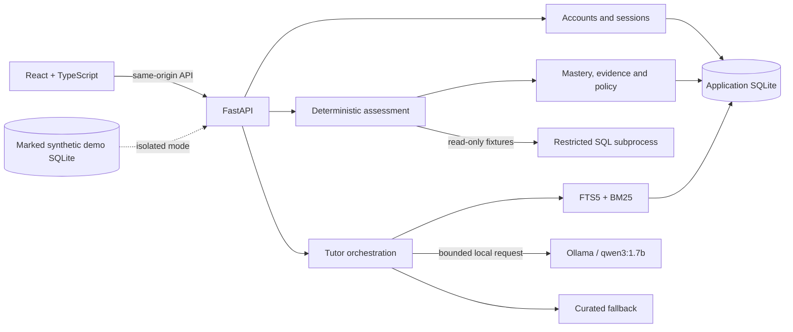
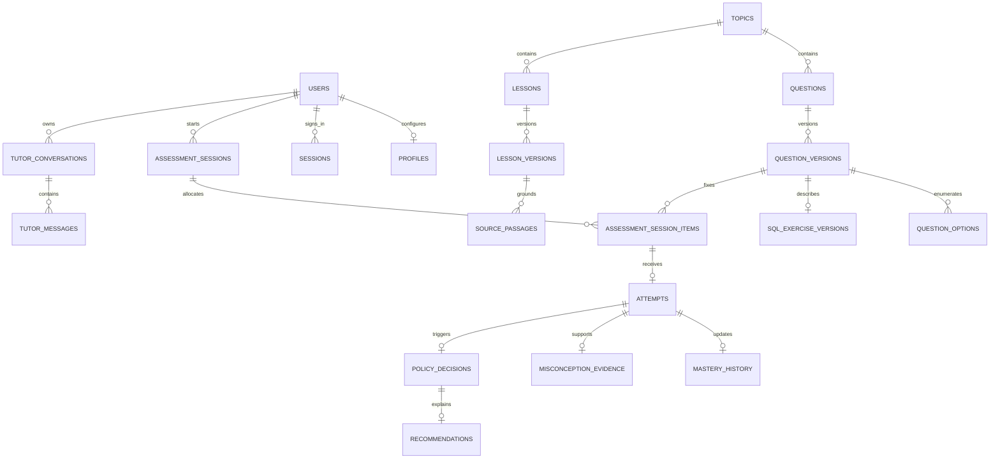

# Architecture and schema

Adaptive DBMS Tutor runs as a React and FastAPI modular monolith. Vite serves the React app and proxies the same-origin API. The backend uses SQLAlchemy and Alembic over SQLite. Ollama serves the configured model on loopback. The SQL worker receives a query and one hash-verified exercise fixture in a temporary directory.

## Assessment transaction

The server allocates a question version before showing the item. It verifies session ownership and never includes correct options, reference SQL or hidden fixture data in learner DTOs. The SQL worker completes before the SQLite write lock. The final `BEGIN IMMEDIATE` rechecks session item ownership, its version and the idempotency fingerprint.

The transaction commits the attempt, mastery history, independent evidence, policy snapshot and recommendation together. The same user, key and payload return the committed result. Reusing the key with a different payload yields HTTP 409. A unique constraint permits one committed attempt per session item.

## Tutoring and sources

Reviewed original lessons and hash-matched cleared book sections are indexed in SQLite. Book counts depend on documents actually present in FTS. Search checks current section rights against its stored metadata. It uses bounded BM25 queries with topic scoping.

The model receives up to four approved passages, recent turns and scoped learning context. The application resolves source IDs against retrieved records, rejects fabricated source IDs and uses curated text on timeout, connection failure, busy inference or malformed output. The model provider has no grading or learner-state write methods.

The configured provider has one inference slot, 4,096 context tokens, up to 384 output tokens and a 30-second total deadline. The starter practice hint gives a general strategy. The application records higher hints before inference and excludes potentially revealing attempts from independent evidence.

## Main relationships

## Schema dictionary

| Tables | Purpose and constraints |
|---|---|
| `users`, `profiles`, `sessions` | Local accounts, Argon2id hash, optional preferences and expiring hashed session tokens. Learner data cascades on account deletion. |
| `topics`, `topic_prerequisites` | Canonical domain and topic IDs with acyclic prerequisite edges. |
| `questions`, `question_versions`, `question_options`, `sql_exercise_versions` | Stable logical question IDs, immutable reviewed versions, MCQ options and versioned fixture hashes/comparison policy. Reserved pools stay reserved across revisions. |
| `lessons`, `lesson_versions` | Immutable authored or cleared reviewed material with attribution and verification metadata. |
| `assessment_sessions`, `assessment_session_items` | Owned, resumable allocations with fixed item positions and hint exposure. |
| `attempts` | Append-only commits with unique session item and unique per-user idempotency key. |
| `mastery`, `mastery_history` | Current bounded score and distinct evidence, review schedule and score changes. |
| `misconceptions`, `misconception_evidence`, `user_misconceptions` | Enabled rules, independent signals and learner-specific hypothesis states. |
| `policy_decisions`, `recommendations` | Versioned reasons and input snapshots sufficient to reproduce next-step choices. |
| `source_passages`, `source_passages_fts`, `source_passages_fts_vocab` | Source and clearance metadata, synchronized full-text index and actual searchable-document counts. |
| `tutor_conversations`, `tutor_messages` | Private histories with a revision check for concurrent follow-ups. |

The [Alembic revisions](../backend/migrations/versions) are the executable schema history. Upgrade a database with `python -m alembic -c backend/alembic.ini upgrade head`.

## Local security model

Sessions use HttpOnly, SameSite=Lax cookies. Mutation routes require a configured Origin or same-origin Referer. The API marks responses as non-cacheable. Signed-in account exports are owner-only and never include session tokens or password hashes. Demo routes require loopback and a marked demo database. See the [SQL worker safeguards and platform limits](sql-worker.md).

Git stores application source, authored draft lessons and test fixtures. Local databases, secrets, virtual environments and model weights are excluded. Approved publisher passages are imported from individually cleared UTF-8 text files, following the [rights workflow](rights_clearance_workflow.md).
